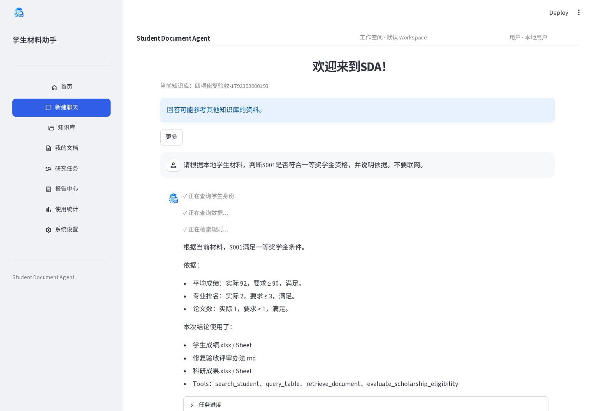
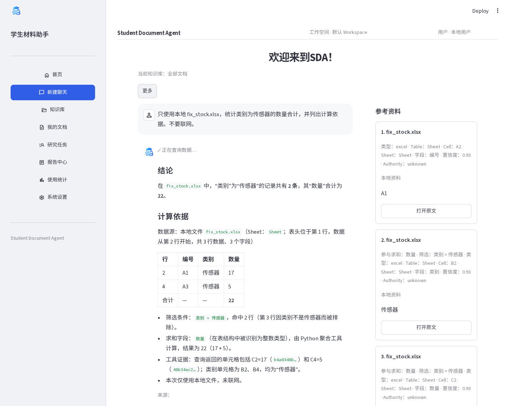
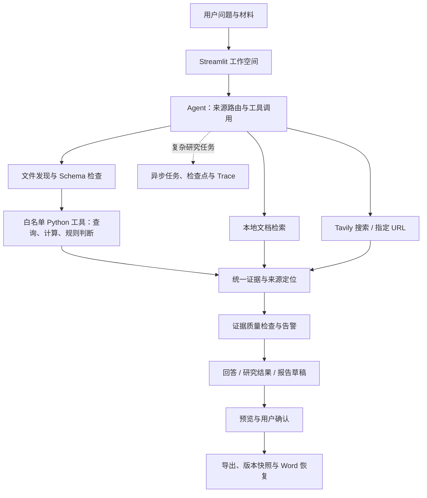

<p align="center">
  
</p>

<h1 align="center">Student Document Agent</h1>

<p align="center">从材料问答、规则判断到研究报告，让工具执行有边界，让结果有来源。</p>

SDA 是面向学生材料的文档研究 Agent。它将文件发现、表格 Schema 检查、工具计算、本地与网页检索，以及确认后的报告交付组织成一个可操作的工作空间。

例如，用户只需问“判断 S001 是否符合一等奖学金资格”，Agent 会发现材料、读取真实表格结构、查询成绩与科研、检索评审规则，再由 Python 工具完成判断。缺材料时说明缺失，重名时要求澄清，文件修改须先预览并由用户确认。

**技术栈：** Python · FastAPI · Pydantic · SQLite · Streamlit · Function Calling · RAG · Tavily

**最新验证（2026-10-19）：** 852 项自动化测试通过；14 项真实 API 场景通过；22 个真实浏览器检查点通过。[查看方法与边界](docs/VALIDATION.md)

## 项目亮点

| 能力 | 实现方式 |
| --- | --- |
| 自然语言驱动工具执行 | 通过 Function Calling 调用白名单工具，以 Pydantic 校验参数；奖学金工作流显式允许有预算的文件发现与 Schema 检查 |
| 计算与规则判断可复查 | 筛选、聚合和资格判断由 Python 执行；聚合记录计算方式、筛选条件、贡献单元格与证据 ID |
| 本地与公开来源联合研究 | 支持本地文档、Tavily 搜索和指定 URL；来源路由与执行器共同限制工具范围，明确“不联网”时仅允许本地工具 |
| 长任务可恢复 | SQLite 持久化任务状态、工具结果与检查点，支持异步研究、取消、重试、恢复及 Trace 查看 |
| 交付需要用户确认 | 报告草稿可导出 Word / Markdown；写入先展示预览，确认后执行，Word 支持版本快照与恢复 |

### 实际界面

以下均为真实前后端与模型验收截图，使用合成材料，不含真实学生资料或认证信息。

**自然语言资格判断：用户不提供文件 ID、字段或工具调用步骤，Agent 自行完成材料发现与规则判断。**



**表格聚合与来源定位：计算结果关联实际参与计算的单元格，并展示筛选条件。**



## 工作流程



系统复用文档解析、检索、Agent Runtime 和证据结构。普通问答、深度研究、报告生成对应不同交互入口，复用后端能力。

## 能力与技术实现

- **文档处理**：支持 PDF、Word、Excel、PowerPoint、Markdown、TXT、JSON、CSV 和图片；保留页码、段落、行号、Sheet、Cell 等定位信息，并具备 OCR 处理路径。
- **表格工具**：读取真实 Schema，通过结构化参数完成筛选、排序、分组和聚合，不执行模型生成的 SQL / Python 表达式。
- **本地检索**：关键词与向量结果融合，使用 RRF 与重排；默认向量实现是本地特征哈希，默认重排是确定性规则，预留可替换接口。
- **Web 检索**：通过 Tavily 查询公开资料，或直接读取指定 URL；网页内容按不可信数据处理，URL 获取包含 SSRF 防护。
- **证据与任务**：Unified Evidence 4.0 关联本地与网页来源；任务保存实际工具调用、阶段和检查点，支持恢复后继续执行。
- **前后端**：FastAPI 提供 API，SQLite 保存任务、证据与版本元数据，Streamlit 提供知识库、聊天、研究任务、报告中心和系统状态页面。

## 快速开始

### 1. 安装

需要 Python 3.10+，以及支持工具调用的 OpenAI-compatible Chat Completions API。仅在需要联网搜索时配置 Tavily。

```bash
git clone https://github.com/Frodo2875/SDA.git
cd SDA
python -m venv .venv
source .venv/bin/activate
pip install -r requirements.txt
```

Windows 使用 `.venv\Scripts\Activate.ps1` 激活环境。

### 2. 配置

```bash
cp .env.example .env
```

在本地 `.env` 中填写：

```dotenv
LLM_API_KEY=
LLM_BASE_URL=
LLM_MODEL=

# 可选：Tavily Web Search
WEB_SEARCH_PROVIDER=tavily
TAVILY_API_KEY=
TAVILY_BASE_URL=https://api.tavily.com
WEB_SEARCH_TIMEOUT_SECONDS=8
WEB_SEARCH_DEFAULT_TOP_K=5
```

模型与搜索配置仅保存在本地。仓库只提供不含认证值的 `.env.example`。

### 3. 启动前后端

```bash
python -m uvicorn backend.main:app --reload --port 8000
```

另开终端：

```bash
source .venv/bin/activate
python -m streamlit run frontend/app.py
```

访问前端 <http://127.0.0.1:8501>；API 文档位于 <http://127.0.0.1:8000/docs>。前端默认连接本机 8000 端口，可通过 `BACKEND_BASE_URL` 覆盖。

### 4. 使用

1. 创建知识库，上传材料并查看解析、索引状态。
2. 进入聊天，选择普通问答、深度研究或报告生成。
3. 查看回答与参考资料，按需打开原文或研究任务详情。
4. 在报告中心预览草稿，确认后导出 Word / Markdown。
5. 长任务可查看 Trace，执行取消、重试或恢复。

仓库内四份示例材料由 `scripts/generate_test_data.py` 生成，全部为虚构数据。学生身份工具沿用 `学生基本信息.xlsx` 等约定文件；前端上传的约定材料也可读取。同名文件不会自动覆盖。

## 测试与验证

```bash
pytest -q
```

| 验证类型 | 2026-10-19 结果 | 含义 |
| --- | --- | --- |
| pytest 回归 | 852 passed，0 failed，0 skipped | 参数、工具、证据、工作流、API、前端等受控回归 |
| 真实 API 专项 | 14 / 14 | 实际模型、多格式问答、聚合、Tavily、跨来源研究与 URL 获取 |
| 真实浏览器验收 | 22 / 22 检查点 | 冷启动资格判断、来源定位、研究、审批下载与 Word 恢复等实际交互 |

真实验证没有替换模型回答或搜索结果。自动化回归中包含固定适配器；这些数字不代表生产准确率。[验证详情与复现方式](docs/VALIDATION.md)

## 安全与能力边界

- 上传文件、OCR 与网页正文均是不可信数据，不能改变工具权限或代替用户确认。
- 以工具白名单、参数 Schema、来源范围与工作流依赖共同约束执行。
- 写入、删除、撤销和恢复须经过用户确认；模型不能调用确认接口自行批准。
- API Key、环境文件、数据库、运行日志、上传材料、版本文件和完整本地验收记录不纳入新提交。
- **证据质量检查仍是告警机制**，不保证逐句事实正确，也尚未形成覆盖全部研究任务的自动补检索闭环。
- **默认面向本地单用户运行**。知识库目前是管理上下文，尚未提供按库检索隔离或多用户权限控制；聊天历史主要保存在浏览器会话。
- 不支持任意 PDF / Excel 原文编辑或任意 Word 原文覆盖；Markdown 导出与 Word 版本恢复的能力不同。

公开部署需另行配置身份认证、访问控制、HTTPS、上传容量限制与备份。OCR、视觉处理及复杂业务的实际效果应另行评估，不能由本轮合成材料验收推断。

## 项目结构

```text
backend/
├── agent.py          # 受控工具调用与回答流程
├── runtime/          # 工作流、异步任务、重试与恢复
├── services/         # 文档、检索、证据、审批与报告
└── tools/            # 白名单查询、计算与规则工具
frontend/             # Streamlit 页面、组件与 API Client
tests/                # 单元、集成、前端与真实浏览器验收
evals/                # 固定评估案例与指标契约
scripts/              # 合成材料生成、隔离验收服务
docs/                 # 架构、公开验证摘要与界面截图
```

当前代码为 V7 基础上的可靠性修复；`v7-final-stable` 是历史冻结标签，不包含本次修复。

- [公开验证记录](docs/VALIDATION.md)
- [V7 架构与既有限制](docs/V7_FINAL_ARCHITECTURE.md)
- [聊天文档操作与确认机制](docs/CHAT_DOCUMENT_ACTIONS.md)
